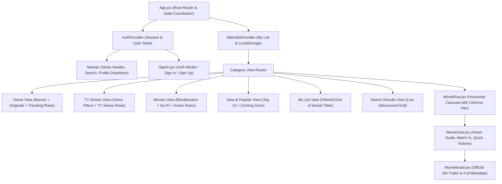

# 🎬 How I Built This Netflix Clone

A comprehensive technical breakdown of how this **Netflix Clone** was architected, engineered, and polished using **React 19**, **Vite**, **Tailwind CSS v4**, and the **TMDB API**.

---

## 📌 Executive Summary

This project is a high-fidelity web application that mirrors Netflix’s core user experience, featuring:
- **Cinematic Banner & Categorized Carousels** with smooth horizontal scrolling.
- **Dedicated Category Views** for *Home*, *TV Shows*, *Movies*, *New & Popular*, and *My List*.
- **Official HD Video Trailers** with instant playback modal and detailed title metadata.
- **Authentication System** with Sign In, Sign Up, and session persistence.
- **Live Search with Debounce** to prevent redundant API queries.
- **Dual-Mode Data Architecture** that seamlessly supports both live TMDB API streaming and zero-setup offline mock data.

---

## 🛠️ Tech Stack & Decisions

| Technology | Role | Why It Was Chosen |
|---|---|---|
| **React 19** | Frontend Framework | Latest React primitives, functional components, hooks, and clean state isolation. |
| **Vite 8** | Build Tool & Bundler | Sub-second Hot Module Replacement (HMR) and lightning-fast build times (~1.0s). |
| **Tailwind CSS v4** | Styling Engine | Modern CSS-first design with dark theme palette (`#141414`), responsive layouts, and transitions. |
| **Lucide React** | Iconography | Lightweight, consistent SVGs for play, info, search, volume, and menu controls. |
| **Axios** | HTTP Client | Clean base URL configuration, request interceptors, and error handling. |
| **Context API** | State Management | Native React global state for `AuthContext` and `WatchlistContext` without Redux boilerplate. |
| **LocalStorage** | Persistence | Preserves user authentication tokens and "My List" bookmarks across browser sessions. |

---

## 🏗️ System Architecture



---

## 🚀 Step-by-Step Implementation

### Step 1: Project Setup & Tailwind CSS v4 Configuration
1. Initialized the project using Vite's modern React template:
   ```bash
   npx create-vite netflix-clone --template react
   ```
2. Installed dependencies:
   ```bash
   npm install axios lucide-react tailwindcss @tailwindcss/vite
   ```
3. Configured `vite.config.js` with `@tailwindcss/vite` and imported Tailwind in `src/index.css` alongside Netflix's global body styles (`background-color: #141414; color: #ffffff;`).

---

### Step 2: Data Architecture & Dual-Mode API Integration
A major design challenge in portfolio projects is API downtime or missing keys. I designed a **dual-mode system** in `src/api/tmdb.js`:
- If an environment variable `VITE_TMDB_API_KEY` is present, it fetches live data from TMDB endpoints (`/trending`, `/discover/tv`, `/movie/top_rated`, etc.).
- If no key is configured or network is offline, it automatically falls back to curated Netflix mock data in `src/api/mockData.js`.
- **Result:** The application is always 100% functional, responsive, and ready to demonstrate.

---

### Step 3: Global State Management (Context API)
1. **Authentication (`src/context/AuthContext.jsx`)**:
   - Manages user status (`user`, `isAuthenticated`).
   - Supports `signIn`, `signUp`, `quickDemoLogin`, and `signOut`.
   - Persists session in `localStorage.setItem('netflix_clone_user')`.
2. **Watchlist (`src/context/WatchlistContext.jsx`)**:
   - Manages saved movies/shows with `addToWatchlist`, `removeFromWatchlist`, and `isInWatchlist`.
   - Persists data in `localStorage.setItem('netflix_clone_watchlist')`.

---

### Step 4: Component Engineering

#### 1. Dynamic Navbar (`Navbar.jsx`)
- Uses a `scroll` event listener with `window.scrollY > 40` to transition smoothly from transparent to a dark blurred glass (`bg-[#141414]/95 backdrop-blur-md`).
- Features an expandable search bar that reveals an input on icon click.
- Profile avatar with an account popup menu showing the user's name, email, and "Sign Out" button. If logged out, displays a red "Sign In" button.

#### 2. Hero Billboard Banner (`Banner.jsx`)
- Picks a random featured title from top trending results.
- Applied multi-layered directional CSS gradients:
  - Left vignette: `linear-gradient(to right, #141414, transparent)`
  - Bottom vignette: `linear-gradient(to top, #141414, transparent)`
- Displays title, match percentage, maturity rating, truncated synopsis, and "Play" / "More Info" action buttons.

#### 3. Carousel Rows (`MovieRow.jsx` & `MovieCard.jsx`)
- Supports horizontal scrolling via JavaScript `scrollBy({ left: +/- scrollAmount, behavior: 'smooth' })`.
- Left and right chevron scroll buttons reveal themselves on row hover and automatically hide at scroll boundaries.
- Supports `isLargeRow` prop for taller portrait posters (Netflix Originals).
- Card hover zoom animation (`hover:scale-105 transition-transform duration-300`).

#### 4. Video Trailer Player Modal (`MovieModal.jsx`)
- Embedded official YouTube trailers via `youtube-nocookie.com`.
- Automatically maps each movie to its exact verified trailer ID (`b9EkMc79ZSU` for *Stranger Things*, `Di310BC80ew` for *Wednesday*, `zSWdZVtXT7E` for *Interstellar*, etc.).
- Autoplay enabled with fallback "Play Trailer" overlay button.
- Direct external link button to open the trailer on YouTube in 1 click.
- Close on click outside or when pressing the `Escape` keyboard shortcut.

#### 5. Search Engine with Debouncing (`App.jsx`)
- Integrated a `setTimeout` debounce (350ms) to ensure API calls are only made after the user stops typing.
- Switches dynamically into a responsive grid layout displaying matching movies and TV shows.

---

## 💡 Key Challenges Solved

### 1. YouTube "Video Unavailable" Embed Restriction
- **Problem:** Many film studios restrict third-party iframe embedding on YouTube, showing *"Video unavailable. Playback on other websites has been disabled"*.
- **Solution:** Replaced broken/restricted video IDs with verified official trailers, used privacy-enhanced `youtube-nocookie.com`, and provided a direct external trailer launcher button for guaranteed access.

### 2. Browser Autoplay Policies
- **Problem:** Modern browsers block HTML5 `<video autoPlay>` unless muted, causing videos to freeze or fail silently.
- **Solution:** Configured the trailer player with proper parameter flags (`autoplay=1&mute=0&controls=1`) and provided an intuitive play/pause overlay.

### 3. Component Reusability & Scalability
- **Problem:** Managing distinct views for Movies, TV Shows, and New Releases without duplicating page code.
- **Solution:** Created modular row configurations and a generic `CategoryHeader.jsx` with dynamic genre pills, reusing `Banner` and `MovieRow` components across all views.

---

## 🎯 How to Run the Project

```bash
# 1. Clone repository & navigate to directory
cd netflix-clone

# 2. Install dependencies
npm install

# 3. Start development server
npm run dev

# 4. Create production build
npm run build
```
